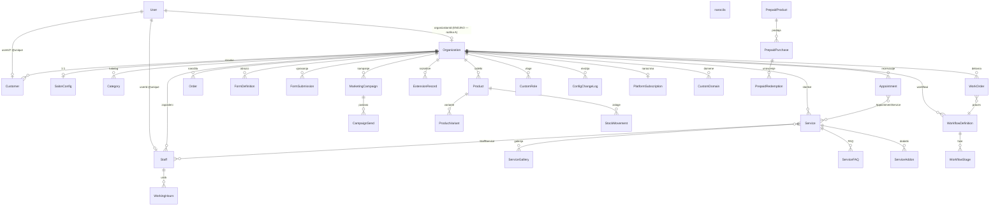

# MARKEC – MY BUSINESS PLATFORM · Arhitekturna analiza (audit)

> **Krovni issue:** #100 · **Sorodno:** MARKEC-NACRT.md (načrt), #101 (no-code izdelovalnik) · **Status:** audit — pred večjo implementacijo
> **Izvedba:** agent (navodila lastnika 5. 11. 2026, komentar 23:06) · **Zadnja posodobitev:** 2026-11-05
> **Metoda:** popolna raziskava kode (brez velike implementacije) + runtime dokazi na lokalni testni bazi (embedded PostgreSQL, port 5433, produkcijski build `next start`)

---

## 0. Namen dokumenta

Dokument je **arhitekturni popis obstoječega stanja** + **ciljna arhitektura** za tri potrdene razlike in varnostno analizo večnajemništva. Služi kot:

1. **inventar**: vsak podatkovni model z lastništvom (§2), vsak modul/površina s stanjem (§3–§5);
2. **matrika issue** → kaj že obstaja (§6);
3. **varnostna analiza** po OWASP Multi-Tenant Security Cheat Sheet, z dokazi in runtime potrditvami (§7);
4. **ciljna arhitektura** za razlike A/B/C (§8) z migracijskim načrtom (§9) in fazami z merili sprejemanja (§10).

**Načelo:** nadgrajujemo obstoječo aplikacijo, ohranimo delujoče funkcije, pred spremembo dokažemo kaj je narejeno. Nič od tega dokumenta ne zahteva prepisa jedra.

---

## 1. Povzetek (executive summary)

**Kaj deluje (z dokazi):** večnajemniško jedro z 51 podatkovnim modeli, 6 route skupin, 17 strani dashboarda, ~247 server actions (41 datotek), 10 API rut + SEO/OG, 2 Stripe webhooka z podpisi, cron z bearer secretom, 11 profilov × 13 capabilityjev × 9 razširitev, ter 851 testov. Rezervacije, trgovina, zaposleni, stranke, obrazci, delovna naročila, depoziti, darilne kartice, ocene, dokumenti, zaloge, analytics, domene, platform konzola — vse **end-to-end deluje**.

**Najpomembnejša varnostna ugotovitev (potrjena v živo):**

> **V-1 — Ponarejen `x-org-slug` header na golih javnih poteh = najemniška impersonacija.**
> Runtime dokaz (produkcijski build, lokalna testna baza, 2026-11-05):
> `curl -H "x-org-slug: studio-nika" http://localhost:3100/` → stran izriše **"Frizerski studio Nika"**;
> `curl -H "x-org-slug: nail-studio-luna" http://localhost:3100/booking` → **HTTP 200**, rezervacijski čarovnik v kontekstu tuje organizacije.
> Vzrok: proxy postavi header izključno pod `/s/*` (`src/proxy.ts:191`), na golih poteh 404 samo če header **manjka** (`proxy.ts:207-209`), `getPublicOrg`/`getResolvedOrg` headerju zaupata brez vezave na host (`src/lib/tenant.ts:29-31,126-128`), header se nikjer ne briše. Dashboard je imun (bere samo sejo). Rešitev: proxy naj header **vedno** nastavi ALI zbriše glede na pot/host (§7.3, F0-S).

**Tri potrdene arhitekturne razlike** (navodila lastnika):

| | Razlika | Današnje stanje | Cilj |
|---|---|---|---|
| **A** | Več podjetij pod enim računom | `User.organizationId` enojen FK — največ 1 organizacija; vloga globalna (`UserRole` na User) | `OrganizationMember` članstvo (User ⋈ Organization, per-org vloga), povabila, izbira aktivnega podjetja, varen prehod seje/guards |
| **B** | Dejavnost neobvezna | onboarding **zahteva** vertical; `Organization.vertical @default("beauty")` | vertical postane izbiren predlog; generična osnova oz. preskok; vseh 11 profilov ohranjeno |
| **C** | Resnično samostojni moduli | `profileOverrides` dovoljuje izklop samo `optional` capabilityjev; jedro vertikale je zaklenjeno | osrednji katalog modulov, aktivacija na ravni podjetja neodvisno od vertikale, konfiguracija, odvisnosti, verzioniranje; izklop ohrani podatke |

**Drugi pomembni najdeni problemi:** migracijska zgodovina ni linearna (`init` je 3. migracija — svež `migrate deploy` od nič ni možen; produkcijska pot je `db push` + inkrementalne migracije), 10 tabel ima nullable `organizationId` (orphan možnost), `Customer.email` ni unique per org, `CustomRole.name` ni unique per org, manjka unsubscribe za marketing (#95), push/PWA in card-on-file modela ne obstajata (izkazano v #97/#99).

---

## 2. Podatkovni model — inventar (51 modelov, 12 enumov)

Vir: `prisma/schema.prisma` (1688 vrstic). Legenda: **TENANT** = direktno `organizationId` · **TENANT-ind** = posredno (prek starša) · **MESH** = vezna tabela · **USER** = globalni uporabnik/auth · **GLOBAL** = platformski podatki.

### 2.1 Razreditev

| Obseg | Št. | Modeli |
|---|---|---|
| TENANT (direktno) | **33** | Organization, PlatformSubscription (1:1), PlatformBillingEvent, PlatformAuditLog, Media\*, CustomRole, SalonConfig (1:1), Category\*, Service\*, Review, Staff\*, Customer\*, WaitlistEntry, MarketingCampaign, Appointment\*, Product\*, Order\*, FormDefinition, FormSubmission, WorkflowDefinition, WorkOrder, WorkOrderEvent, ExtensionRecord, ProductVariant, PrepaidProduct, PrepaidPurchase, Document, DocumentItem, CustomDomain, StockMovement, Project, ProjectTask, ConfigChangeLog (\* = **nullable** organizationId — šibka tenanca) |
| TENANT-ind | **6** | ServiceGallery, ServiceFAQ, ServiceAddon, CampaignSend, WorkflowStage, WorkingHours |
| MESH | **5** | StaffService, AppointmentService, OrderItem, PackageItem, PrepaidRedemption |
| USER | **5** | User, Account, Session, VerificationToken, NotificationPreferences |
| GLOBAL | **2** | PlatformWebhookFailure, JobRun |
| **Skupaj** | **51** | |

### 2.2 Ključni modeli za razlike A/B/C

**Organization** (koren najemnika): `id`, `slug @unique`, `name`, `logo?`, **`vertical @default("beauty")`**, `palette @default("rose")`, `plan @default("free")`, `status` (ACTIVE\|SUSPENDED), `publishState` (DRAFT\|PUBLISHED\|UNPUBLISHED), `publishedAt?`, `contentVersion`, **`profileVersion?`**, **`profileOverrides Json?`** (`{v:1, capabilityStates?, dashboardWidgets?}`), **`verticalChosenAt?`**, `setupChecklist Json?`, **`onboardingAnswers Json?`** (`{teamSize, onlineBooking}`), **`secondaryVertical?`** (unija kapabilitet), `stripeSecretKey?`, `stripeWebhookSecret?`, `configChangeLogs[]`, ~34 relacij. ➜ Razlika C: `profileOverrides` je edini mehanizem prilagajanja in pokriva samo `optional` capabilityje; razlika B: `verticalChosenAt`/`vertical` so zasnovani kot obvezna pot.

**User**: `email @unique`, `password?`, `emailVerified?`, **`role UserRole @default(CLIENTE)` (GLOBALNA vloga, ne per-org)**, **`organizationId String?` (ENOJNI FK, onDelete SetNull)**, `customRoleId?` → CustomRole, `staff?` (1:1, obvezna če role=STAFF), `customer?` (1:1 opcijsko), `resetToken?`. ➜ Razlika A: enojno članstvo je temeljna omejitev; vloga ni per-organizacija.

**CustomRole**: `organizationId` (obvezno), `name` (**ni unique per org**), `permissions Json` (array `PermissionKey`). Permission katalog živi v kodi: `src/lib/permissions/roles.ts` — 12 ključev, 4 skupine. `Permission` model ne obstaja.

**Profile/capabilities shranjevanje**: `Organization.profileOverrides` + `profileVersion` + `secondaryVertical`; revizija prek `ConfigChangeLog` (unique `(organizationId, entityKey, version)`); provenance: `FormDefinition.sourceProfile`, `WorkflowDefinition.sourceProfile`, `Category/Service/Product.presetSeed`. Profili so v **kodnem registru** (`src/lib/profiles/registry.ts`) — ni `ProfileDefinition` tabele (copy-on-write materializacija).

### 2.3 Enumi

`UserRole` (ADMIN\|STAFF\|CLIENTE), `CampaignKind` (REACTIVATION\|NO_SHOW), `AppointmentStatus` (PENDING\|CONFIRMED\|COMPLETED\|CANCELLED\|NO_SHOW), `DepositType` (INHERIT\|NONE\|FIXED\|PERCENT), `CommissionType` (NONE\|PERCENT\|FIXED), `OrderStatus` (PENDING\|PAID\|COMPLETED\|CANCELLED\|REFUNDED), `PrepaidKind` (GIFT_CARD\|PACKAGE\|MEMBERSHIP — MEMBERSHIP rezerviran, ne-implementiran), `StockDirection` (IN\|OUT), `StockMovementSource` (MANUAL\|ORDER\|DELIVERY\|STOCKTAKE\|RETURN), `ProjectStatus`, `ProjectTaskStatus`, `WaitlistStatus`. Polstring statusi: `Organization.status`, `publishState`, `FormSubmission.status`, `WorkOrder.status/priority`, `Document.type/status`, `PrepaidPurchase.status`, `CustomDomain.status`, `ConfigChangeLog.action`.

### 2.4 Unique pravila per najemnik (dedup)

`[organizationId, slug]` (Category, Service), `[organizationId, sku]` + `[organizationId, barcode]` (Product), `[organizationId, kind]` (MarketingCampaign), `[organizationId, key]` (FormDefinition, WorkflowDefinition), `[organizationId, number]` (WorkOrder), `[organizationId, type, number]` (Document), `[organizationId, entityKey, version]` (ConfigChangeLog), `organizationId @unique` (SalonConfig, PlatformSubscription). **Globalni unique**: `PrepaidPurchase.code`, `CustomDomain.domain`, `Appointment.stripePaymentId`, `PlatformBillingEvent.stripeEventId`, `User.email`, `Staff.userId`.

### 2.5 ER diagram (jedro, mermaid)



### 2.6 Opažanja (potencialna zaostritev — ločen sklop)

1. Nullable `organizationId` na 9 tenant tabelah (historična zapuščina pre-tenancy) — omogoča orphan vrstice; kandidat za NOT NULL + backfill po produkcijski preverbi (V-2).
2. `Customer.email/phone` nista unique per org — dedup v rokah aplikacije.
3. `CustomRole.name` ni unique znotraj organizacije.
4. `PlatformAuditLog` je org-scoped (ne globalen); pravi globalni sta samo `PlatformWebhookFailure` in `JobRun`.
5. `Staff`/`Customer` teoretično brez orga (nullable) — vsi klici v praksi iščejo iz seje, a schema to ne jamči.

---

## 3. Moduli in funkcijske površine

### 3.1 Route skupine (6)

| Skupina | Poti | Vrata |
|---|---|---|
| `(auth)` | `/login`, `/register`, `/forgot-password`, `/reset-password`, `/verify-email`, **`/start`** (onboarding) | javno |
| `(admin)` | `/dashboard` + 17 podmap (analytics, appointments(+new,[id]), documents, forms, marketing, orders(+[id]), packages, products(+new,[id],stocktake), projects(+[id]), records, roles, services(+new,[id]), settings, staff(+new,[id]), users(+[id]), waitlist, work-orders(+[id])) | proxy ADMIN + per-page `requirePagePermission` |
| `(public)` | `/s/[slug]` prepisana stran: home, `preview` (owner-gate), `services(+[slug])`, `staff(+[name])`, `booking/success|cancel`, terms/privacy/cookies | `x-org-slug` header (V-1!) |
| `(customer)` | `booking` (4-koračni čarovnik), `inquiry`, `shop(+[slug],gift/success)`, `cart`, `checkout/*`, `my-account`, `my-appointments`, `my-orders(+[id])`, `my-reviews` | CLIENTE+ADMIN oz. javno |
| `(staff)` | `/staff-portal` + appointments, schedule, profile | proxy STAFF(+ADMIN) — ⚠️ neskladje layouta (V-8) |
| `(platform)` | `/platform`, `/platform/tenants/[id]` | `PLATFORM_ADMIN_EMAILS` fail-closed |

**Mehanizem javnih strani:** `/s/[slug]/*` nima lastnih page.tsx — `src/proxy.ts` prepisuje na golo pot in nastavi `x-org-slug` header; `(public)`/`(customer)` layouti berejo prek `getPublicOrg()`. Neznana/suspendirana najemnika → pravi 404; DRAFT → 404 razen lastniku.

### 3.2 API poti (10 + SEO/OG)

| Pot | Avtentikacija | Stanje |
|---|---|---|
| `api/auth/[...nextauth]` | Auth.js v5 (credentials, JWT) | deluje |
| `api/cron/tick` | `Bearer CRON_SECRET`, brez secret → vedno 401 | deluje (3 jobi) |
| `api/health` | javen, brez DB | deluje |
| `api/health/internal` | `requirePlatformAdmin` fail-closed | deluje |
| `api/upload` | seja obvezna, org iz **seje**, server-generated public_id, quota | deluje |
| `api/media/[id]` | **brez preverbe** (public-by-id, cuid) | deluje — V-3 |
| `api/public/resolve-tenant` | javno (namenoma) — razkrije orgId+publishState | deluje — V-4 delno |
| `api/public/entity-exists` | javno; org iz query parama | deluje — V-4 |
| `api/webhooks/stripe` | per-org signature verifikacija, fail-closed | deluje |
| `api/webhooks/platform-stripe` | platform secret fail-closed, idempotenca | deluje |
| `s/[slug]/sitemap.xml`, `robots.txt` | javno, samo PUBLISHED+ACTIVE | deluje |
| `og/route.tsx` | javno | deluje (MARKEC) |
| — push — | **ne obstaja** | #99 |

### 3.3 Server actions (41 datotek, ≈247 izvoženih funkcij)

auth 4, account 10, users 10, custom-roles 6, customers 1, onboarding 2, guided-entry 2, profile 5, settings 3, publication 3, site-content 9, analytics-settings 2, domains 5, config-history 3, setup-checklist 3, appointments 17, waitlist 5, services 14, categories 1, catalog 9, staff 19, products 6, product-checkout 2, cart 1, orders 7, inventory 6, prepaid 9, work-orders 8, projects 11, forms 8, documents 6, records 7, marketing 3, reviews 5, stripe 3, payments 3, billing 3, plans 2, analytics 7, dashboard 4, platform 2.

**Vladajoči vzorec zaščite:** guard (`requirePermissionOrg`) → org iz **seje** (`resolveSessionOrg`) → poizvedba z `organizationId: org.id`. Klientov `organizationId` kot argument: samo 1 izvožena akcija `getOrgTimezone` (nizka resnost, V-5). Javne akcije: org iz request konteksta (`getResolvedOrg`/`requirePublicOrg`).

### 3.4 Cron / webhooki

Vercel cron `/api/cron/tick` (`vercel.json`: dnevno 03:00 UTC — ⚠️ komentar v ruti pravi "15 min", uskladiti): 3 jobi vsak z `JobRun` dnevnikom — `send-due-reminders` (24 h opomniki), `expire-stale-pending` (zastareli PENDING → CANCELLED; minuli CONFIRMED → NO_SHOW), `send-marketing-emails` (#95). Webhooka: najemniški Stripe (multi-org podpisi) + platform billing (edini pisatelj naročnin).

### 3.5 Profilni sistem

- **Registry** (`src/lib/profiles/registry.ts`) — 11 profilov: `beauty`, `frizer`, `barber`, `nails`, `cosmetica`, `massage`, `epilation`, `generic`, `seamstress`, `tire-service`, `beekeeping`.
- **13 capability ključev**: appointments, workOrders, shop, services, inventory, customers, staff, analytics, reviews, forms, workflows, documents, delivery.
- **9 razširitev** (`extensions.ts`): `vehicle-workshop`, `body-measurements`, `batch-production`, `workspace-resources` (gen-1); `projects`, `multi-location`, `memberships`, `suppliers`, `delivery-runtime` (gen-2 — zadnje tri deklarirane brez runtimea).
- **Tipi capability**: `required` (jedro vertikale — NI izklopljivo), `optional` (izklopljivo), `disabled` (nikoli nič).
- **Override** (`overrides.ts` + `modules-configurator.tsx`): `Organization.profileOverrides` = `{v:1, capabilityStates?, dashboardWidgets?}`; resolve vrstni red: registry primarne → sekundarna (unija) → overrides (zadnja beseda); akciji `updateOrgOverrides`/`resetOrgOverrides`, napaki `CAPABILITY_NOT_OPTIONAL`/`INVALID_WIDGET`; izklop takoj vpliva na sidebar/dashboard/javno stran. **Razlika C gradi tukaj.**
- **Terminologija per profil** (SL/EN, sklanjanje #84), `website.ctaMode` (booking/inquiry/order/quote), `catalog.seedVerticalId`, `palette`, `schemaType` (JSON-LD).

### 3.6 Marketing v1 (#95)

End-to-end deluje: 2 avtomatski kampanji (REAKTIVATION po prag dni, NO_SHOW včeraj) → cron → Resend → dedup (`CampaignSend` unique `[campaignId, email, triggerKey]`) → `sentCount`. **Manjka:** prava odjava (unsubscribe link + seznam) — v1 poštenost je samo opomba v e-pošti; zgodovina pošiljk; natančna predogled številka v salon-TZ; segmentiranje po oznakah.

---

## 4. Dovoljenja in vrstni red preverjanja

1. **Proxy** (`src/proxy.ts`): route/vloga vrata — `/dashboard` ADMIN, `/staff-portal` STAFF+ADMIN, `/my-account` CLIENTE+ADMIN, `/platform` env allowlist (redirect-only UX — **ne varnostna meja**).
2. **Page guard** (`src/lib/auth/guards.ts`): `requirePagePermission(key)` — na vsaki admin strani (28 strani).
3. **Action guard**: `requireSession` → `requireRole([…])` → `requirePermissionOrg(key)` (ADMIN + sveže pravice + org iz seje).
4. **Effective permissions** (`effective.ts`): **sveže branje iz DB vsakič** (JWT ne šteje) — sprememba vloge deluje takoj.
5. **Katalog** (`roles.ts`): 12 ključev; pravilo G8 — custom role RESTRICTS, brez njega ADMIN/STAFF imajo vse.
6. **Platform** (`guard.ts`): `requirePlatformAdmin` — izključno `PLATFORM_ADMIN_EMAILS`, prazen seznam = nihče.
7. **Capabilities** — ločena raven: nav je pogojen z capability **in** pravico.

---

## 5. Stanje po modulih

| Modul | Stanje | Dokaz / opomba |
|---|---|---|
| Rezervacije | ✅ deluje | appointments 17 f., zaklepanje, dodatki, viri, depozit, opomniki, waitlist, javni čarovnik |
| Trgovina | ✅ deluje | variants, packages, Stripe checkout, košarica, guest checkout, odšteto stanje |
| Zaposleni | ✅ deluje | 19 f., prirejanje storitev, urnik, staff-portal |
| Storitve | ✅ deluje | 14 f., dodatki, kategorije, deposit pravila per storitev |
| Stranke | ✅ deluje | iskanje, oznake (#91), leadi, izvozi |
| Marketing | ⚠️ deluje (v1) | 2 kampanji end-to-end; manjka odjava, zgodovina, segmenti |
| Obrazci | ✅ deluje | materializacija iz profila, polimorfni kontekst (#96), urejevalnik, pretvorba v delovni nalog |
| Delovna naročila / projekti | ✅ deluje | workflow stopnje, per-org številčenje, projekti+naloge |
| Dokumenti | ✅ deluje | ponudba→račun, per-org+tip številčenje |
| Depoziti | ✅ deluje | INHERIT/NONE/FIXED/PERCENT, Stripe, webhook, testi |
| Plačila | ✅ deluje | org Stripe ključi, darilne/predplačniške (#80), platform naročnine + plan limits |
| Zaloge | ✅ deluje | gibi, prevzemi, inventura, low-stock |
| Analytics | ✅ deluje | KPI, GA4, platform analytics |
| Ocene | ✅ deluje | pravila + capability-gated javna sekcija |
| Evidenca razširitev | ✅ deluje | ExtensionRecord CRUD (vozila, kompleti, merilni listi, serije) |
| Onboarding / profil / objava / domene | ✅ deluje | /start 3 koraki, checklist iz podatkov, publish gate, Vercel domene |
| Platform konzola | ✅ deluje | overview, suspend/reactivate + audit, webhook failure števci |
| Card-on-file | ❌ manjka | ni modela privolitev/shranjenih kartic — #97 |
| PWA / push | ❌ manjka (manifest ✅) | ni SW, ni VAPID, ni subscription — #99 |
| Walk-in kot samostojen modul | ⚠️ delno | guest polja na Appointment/Order/PrepaidPurchase delujejo; ni ločenega modula/UI — #98 |
| Blog | ❌ manjka | 0 zadetkov; SEO pokrit drugje |
| Odjava od e-pošte | ❌ manjka | #95 (uporabnik: mora biti funkcionalna) |

---

## 6. Matrika issue → obstoječe stanje

| Issue | Tema | Stanje danes | Naslednji korak |
|---|---|---|---|
| #94 | UI/UX kvaliteta, WCAG, kontrasti | večina zaključena (CI kontrastna zascita, znacka fix) | zaključek po checklisti v issue |
| #95 | Marketing avtomatika | v1 deluje; odjava NI funkcionalna | **odjava** + zgodovina + birthday (WIP #95 v stashu) |
| #96 | Dinamični obrazci | kontekst `contextType/contextId` deluje | dopolnitve po issue |
| #97 | Card-on-file | nič (model privolitev manjka) | F: privolitev→avtorizacija→varnost→vračila |
| #98 | Walk-in | guest polja delujejo, modul ne obstaja | samostojen modul za vse dejavnosti |
| #99 | PWA/push | samo manifest | F: SW + VAPID + subscription |
| #100 | MARKEC krovna arhitektura | **F0 pushano** (d58130f, 141ef12, 36ddc1b); ta audit | F1+ po odobritvi |
| #101 | No-code izdelovalnik | pod-issue #100, nič | ločen podprojekt po F1–F3 |

---

## 7. Varnostna analiza večnajemništva (OWASP MT checklist)

### 7.1 Preslikava na OWASP Multi-Tenant Security Cheat Sheet

| OWASP zahteva | Stanje | Dokaz |
|---|---|---|
| Tenant iz preverjene seje (ne klienta) | ✅ za dashboard/akcije; ❌ za javne poti (V-1) | `guards.ts:120-135` org iz seje; `tenant.ts:29-31` header zaupan |
| Avtorizacija na vsaki zahtevi | ✅ | per-page + per-action guards, sveže DB branje pravic |
| Izolacija podatkov (query filter) | ✅ po konstrukciji; ⚠️ legacy NULL (V-2) | `tests/schema-tenancy.test.ts:83-109` schema guardrail |
| Cache izolacija | ✅ | ni `unstable_cache`; proxy cache ključi vključujejo orgId (`proxy.ts:87-100`) |
| Webhook integriteta | ✅ | podpisi per-org / platform, fail-closed, idempotenca |
| Cron avtentikacija | ✅ | bearer secret, brez secret → 401 |
| Media/varna obdelava datotek | ⚠️ | server-generated public_id + quota (upload); branje public-by-id (V-3) |
| Javne strani | ⚠️ | publish gate deluje; header impersonacija (V-1); DRAFT probing (V-4) |
| Negativni testi z več najemniki | ✅ delno | `e2e/idor.spec.ts`, `verify-tenant-isolation.ts`, `guard-rules.test.ts`, prepaid foreign-reject, lock keys; **manjka**: V-1, V-4, media ownership |
| Rate limiting / obramba zlorabe | ❌ | onboarding brez rate-limita (V-8) |

### 7.2 Seznam vrzeli (z dokazi, rangirano)

**MEDIUM**

- **V-1 — Ponarejen `x-org-slug` na golih javnih poteh (POTRJENO V ŽIVO).** Proxy postavi header samo pod `/s/*` (`proxy.ts:191`), 404 na golih poteh samo ko header manjka (`proxy.ts:207-209`), header se nikjer ne briše; `getPublicOrg`/`getResolvedOrg` zaupata brez vezave na host (`tenant.ts:29-31,126-128`). Učinek (dokazano): tuja vsebina izrisana na platformski domeni; rezervacije/waitlist/inquiry/karta v tujem najemniku; `validateCartStock` razkrije ime+zalogo tujih izdelkov. Dashboard/akcije so imuni.
- **V-2 — Legacy NULL-`organizationId` v plačilnih poteh (POGOJNO).** `stripe.ts:623-626`, `product-checkout.ts:712-720`, `webhooks/stripe/route.ts:214-222`: check `if (organizationId && org && …)` spusti tenant-check za NULL vrstico; celo backfill iz metadata (`:146-148`). Na testni bazi: **0 NULL vrstic** (seed); **zahteva produkcijsko SQL preverbo** — če obstajajo, zaočiti NOT NULL + backfill.
- **V-3 — `/api/media/[id]` public-by-id.** `media/[id]/route.ts:10-23` brez auth/org; immutable 1-letni cache; vsebuje tudi avatarje (org=null). Zaščita = neguessable cuid. Priporočeno: obdrži javnost objavljenih tenant medijev, org-gate ali short-signed URL za ostale.

**LOW**

- **V-4** — existence-oracle na DRAFT najemnikih (`resolve-tenant` razkrije orgId+publishState; `entity-exists` ne preveri publishState).
- **V-5** — `getOrgTimezone(organizationId)` javna akcija s klientovim orgId (samo timezone-oracle).
- **V-6** — `public-site.ts:44` resolver ni usklajen z E3-8 (layout pokriva; poravnati).
- **V-7** — podpis z org-A secret lahko cilja org-B prek `metadata.orgId` (zahteva kompromitiran secret; platform webhook to eksplicitno rešuje, tenant ne).
- **V-8** — `(staff)/layout.tsx:14` samo STAFF vs proxy STAFF+ADMIN (ADMIN → /login); CLIENTE avatar brez kvote; onboarding brez rate-limita.

**Pozitivno (ohraniti):** org filter po konstrukciji + schema guardrail test; header-wins pravilo proti sejni kontaminaciji (`tenant.ts:117-123`); fail-closed cron/webhook/platform; dokumentirane bezbednostne odločitve (E3-1/E3-5/E3-8, #24, #44, #72, #83); e2e IDOR dokaz na realnem HTTP.

### 7.3 Predlagani varnostni sklop (F0-S, majhen in ločen)

1. **Fix V-1**: proxy header upravljanje — na vsaki poteh, ki NI `/s/<slug>/*` in NI preverjena custom domena, `requestHeaders.delete(ORG_HEADER)`; dodati e2e negativni test (forged header na `/`, `/booking`, `/cart` → izhodi neodvisni od headerja).
2. **Preverba V-2 na produkcijski bazi** (SQL count NULL) → če 0, opcijsko zaočiti schema NOT NULL v ločeni migraciji.
3. **Negativni testi** za V-4 (entity-exists na DRAFT → 404/no-op) in media ownership.
4. Rate limit na `/start` in javne akcije (zmerno, brez nove infrastrukture).

Merilo sprejemanja: vsak fix z negativnim testom, ki prej faila.

---

## 8. Ciljna arhitektura — tri potrdene razlike

### 8.A Več podjetij pod enim računom

**Današnje stanje:** `User.organizationId` enojen FK; `User.role` globalen; `Staff.userId @unique` (1:1 z User); `Customer.userId? @unique`; NextAuth JWT nosi `role` + `organizationId` (`auth.ts:75-115`); guards berou `session.user.organizationId`.

**Ciljni model:**

```prisma
model OrganizationMember {
  id             String   @id @default(cuid())
  organizationId String
  userId         String
  role           String   // ADMIN | STAFF | CLIENTE per ORG
  customRoleId   String?
  isDefault      Boolean  @default(false)  // aktivna org po prijavi
  createdAt      DateTime @default(now())
  @@unique([organizationId, userId])
  @@index([userId])
}
```

- `User.organizationId` **ostane** kot napovednik privzete org med prehodom (branje starih poti), a postane odvisno polje; avtoritativni vir članstev = `OrganizationMember`.
- `User.role` postane "primarna vloga" (za povratno združljivost); guards ga postopoma nadomesti z `member.role`.
- **Seja:** JWT dobi `memberships: [{orgId, role}]` (ali `currentOrgId` + strežniško branje članstev — odločitev na implementaciji; priporočeno: JWT nosi samo `currentOrgId`, role se branje sveže iz `OrganizationMember` — enaka filozofija kot `effective.ts`).
- **Aktivna organizacija:** switcher v sidebaru; menjava = `unstable_update` seje (JWT) + revalidate; URL ne nosi org.
- **Povabila:** `OrganizationInvite` (org, e-pošta, vloga, token, expiry) + javna sprejemna ruta; pri pozivu obstoječega User se samo doda članstvo.
- **Guards:** `resolveSessionOrg` razširjen: session org **mora biti** med članstvi (zaščita proti starim JWT-jem); `requirePermissionOrg` gleda role iz članstva.
- **Staff/Customer:** ostane 1:1 na (User, Organization) paru — Staff v več podjetjih = več Staff vrstic z istim userId ⇒ **sprosti** `Staff.userId @unique` na `@@unique([userId, organizationId])`; enako razmislek za `Customer.userId?` (opcijski 1:1 → unique par).
- **Platform konzola:** ostaja neizmenjana (email allowlist, ne članstva).
- **Migracijski načrt obstoječih računov:** (1) nova tabela + backfill iz `User.organizationId`/`User.role` (1 članstvo na uporabnika, `isDefault=true`); (2) dvojno branje (member ALI legacy) — ena izdaja; (3) UI switcher; (4) šele nato cleanup legacy polj. Brez brisanja podatkov na vsakem koraku.

### 8.B Dejavnost ni obvezna

**Današnje stanje:** `/start` korak 1 zahteva vertical (`validateStep` + `createSalonOrganization`); `Organization.vertical @default("beauty")`; `isCapabilityEnabled` deluje čisto nad effective profile; capabilities določajo nav/dashboard/javne sekcije; `verticalChosenAt` obstaja.

**Cilj:** vertical = **neobvezna predloga**:
1. Korak 1 v čarovniku dobi **"Preskoči dejavnost"** (izbira: generic osnova ali preskok brez izbire) — vseh 11 profilov, terminologije, obrazcev, workflowov, razširitev in obstoječih nastavitev ostane nespremenjeno.
2. `Organization.vertical` dobi lahko `null` oz. ostane `"beauty"` default, a logika gleda **nov flag** `verticalSkipped` (ali: `verticalChosenAt = null` in `verticalSkipped = true`) — odločitev za en mehanizem na implementaciji; prednost: flag je ekspliciten, ne impliciten prek časa.
3. `effective profile` pri preskoku = `generic` brez priporočenih obrazcev/workflowov (ali prazen profil z vsemi optional capabilitymi **privzeto on** — po odločitvi lastnika; priporočeno: generic z običajnim setom).
4. **Več predlog:** sekundarna vertikala že obstaja (unija); neodvisnost modulov (8.C) naredi vertikalno izbiro čisto predlagalno — priporočeni moduli iz SKD kataloga (F1), nikoli zaklep.
5. **Odvisnosti, ki jih je treba potrditi pri implementaciji:** `seedOrganizationCatalog` (samo pri izbiri vertical), `materializeProfileAssets` (preskočljivo), `staff` materializacija (že pogojno izvedena — P2 #47), terminologija (generic obstaja), `ctaMode` (generic = inquiry/booking izbira v nastavitvah), setup-checklist (korak "vertical" postane izbiren), analytics po capability (že capability-gated).

### 8.C Resnično samostojni moduli

**Današnje stanje:** `profileOverrides` pokriva samo `optional` capabilityje (switchi v `modules-configurator.tsx`); `required` capabilityje vertikale je nemogoče izklopiti; vklop `disabled` capabilityja ni možen; override je binary (optional\|disabled) brez per-module konfiguracije in odvisnosti.

**Ciljni model — osrednji katalog modulov:**

1. **Katalog v kodi** (`src/lib/modules/catalog.ts`): vsak modul = `{ id, name, description, capabilities[], dashboardWidgets[], publicSections[], dependsOn[], dataTables[], version }`. Modul ≠ capability: capability je pravica/stanje UI, modul je poslovna funkcija (npr. "shop" modul vključuje shop capability + products/orders/inventory podatke + javno sekcijo).
2. **Aktivacija na ravni podjetja:** `Organization.moduleStates Json` (ali ločena tabela `OrganizationModuleState` — priporočeno tabela za verzioniranje in zgodovino): `{ moduleId, state: ACTIVE|DEACTIVATED|HIDDEN, config Json, updatedAt }`.
3. **Resolve vrstni red:** registry vertikale (predlogi) → sekundarna (unija) → **moduleStates (zadnja beseda, neodvisno od vertikale)** → overrides (ostane za capability fino nastavljanje; postopoma se združi).
4. **Modul vklop ne glede na vertikalo:** vsak modul iz kataloga je vklopljiv v vsaki org; vertikala samo **priporoči** prednastavitve (F1 SKD mapiranje).
5. **Odvisnosti:** vklop modula z neizpolnjenimi `dependsOn` → priporočena vklop ali zavrnitev z jasnim sporočilom (ne tihka kaskada); izklop modula, od katerega je odvisen drug → opozorilo.
6. **Izklop ohrani podatke:** DEACTIVATED = koda ne izpostavi UI/API, podatki ostanejo (rezervacije, zgodovina, nastavitve, odprte obveznosti — depoziti, prepaid obveznosti ostanejo vidne operaterju v zaščitenem načinu); HIDDEN = samo skrito iz javne strani; **ARHIVIRANJE** = read-only; **BRISANJE** = ločen ekspliciten proces z potrditvijo (izven obsega izklopa). Vsa štiri stanja so ločena; brisanje nikoli ni sledeč učinek izklopa.
7. **Verzioniranje:** vsaka sprememba stanja → `ConfigChangeLog` (`entityKey: "module:{id}"`), rollback-abilno.
8. **Merilo združljivosti:** obstoječa stanja najemnikov se preslikajo: `optional capability disabled` → modul DEACTIVATED; `required` → ACTIVE (zagotovljeno vse deluje takoj po migraciji — **brez spremembe vedenja**).

---

## 9. Migracijski načrt (po korakih, brez brisanja)

| Korak | Vsebina | Pogoj |
|---|---|---|
| M1 | `OrganizationMember` tabela + backfill iz User (1 članstvo) | odobritev modela |
| M2 | dvojno branje v guards (member ALI legacy) + testi | M1 |
| M3 | UI izbira aktivnega podjetja + povabila | M2 |
| M4 | sprostitev `Staff.userId` unique → par; Customer par | M2 (odločitev lastnika) |
| M5 | `moduleStates` tabela + preslikava obstoječih overrides | odobritev 8.C |
| M6 | katalog modulov + resolve + configurator v2 | M5 |
| M7 | vertical preskok flag + čarovnik korak 1 preskok | odobritev 8.B |
| M8 | cleanup legacy polj (šele po dveh stabilnih različicah) | M1–M7 stabilni |

Vsak korak: ločen commit + testi + lint + HTTP dokazi (pravilo 9). Varnostni sklop F0-S (§7.3) gre pred M1–M8.

---

## 10. Faze z merili sprejemanja

| Faza | Vsebina | Merila sprejemanja |
|---|---|---|
| **F0-S** (nova) | varnostni sklop: V-1 fix + negativni e2e, V-2 produkcijska preverba, V-4 test, rate limit | forged-header test faila prej / gre po; testi 851+ zeleni; lint čist |
| **F1** | SKD 2025 katalog (podatkovna datoteka, 22 sekcij A–V mapiranje, več izbir, lastne oznake, preskok) + predlogi modulov brez zaklepa | katalog shranjevanje na Organization; preskok deluje v čarovniku; testi |
| **F2** | #95 dopolnitev: funkcionalna odjava (link + seznam + branje pri pošiljanju), birthday kampanja (WIP v stashu), zgodovina pošiljk | odjava dejansko prekine pošiljanje; testi + HTTP dokazi |
| **F3** | #98 walk-in samostojen modul za vse dejavnosti | modul vklopljiv/izklopljen neodvisno; termin/guest tok deluje |
| **F4** | #96 obrazci dopolnitve, #99 PWA/push, #97 card-on-file (privolitev→avtorizacija→varnost→vračila) | po issue specifikacijah, vsak ločen |
| **F5** | razlike A (M1–M3, M4), C (M5–M6), B (M7) po §8 | vsak korak z migracijskim dokazom na testni bazi |
| **F6** | #101 no-code izdelovalnik (ločen podprojekt) | načrt podatkovnega modela odobren pred kodo |

**Vršni red predlagan:** F0-S → F1 → F2 → F3 → F4 (po prioriteti lastnika) → F5 → F6. F0-S in F1 sta majhna in neodvisna; A/B/C (F5) zahtevajo odobritev modelov iz §8 pred kodo.

---

## 11. Odprta vprašanja za odločitev lastnika

1. **8.A:** ali JWT nosi samo `currentOrgId` (priporočeno) ali vse članstva? Ali dovolimo STAFF v več podjetjih (M4)?
2. **8.B:** preskok = `verticalSkipped` flag (priporočeno) ali nullable `vertical`? Privzeti capability set pri preskoku (generic standard ali vse-optional-on)?
3. **8.C:** `moduleStates` kot JSON polje ali tabela (priporočeno tabela)? Kateri moduli so v prvem katalogu (priporočeno: 13 capabilityjem ustrezajočih + walk-in)?
4. **V-2:** kdaj je na voljo produkcijska SQL preverba (ali pošljem query v issue za ročni zagon)?
5. **Migracije:** nasloviti ne-linearno zgodovino (`init` na 3. mestu) — ohraniti status quo z dokumentacijo (priporočeno za zdaj) ali pripraviti squashed bazično migracijo (ločen tvegan sklop)?
6. **Cron:** dnevno (vercel.json) ali 15-min (komentar) — kateri je nameran ritem opomnikov/marketinga?
